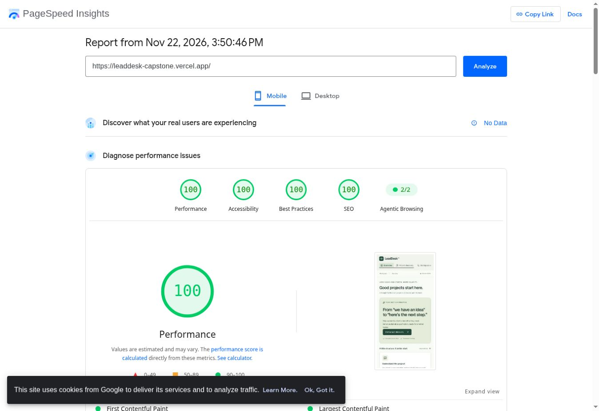
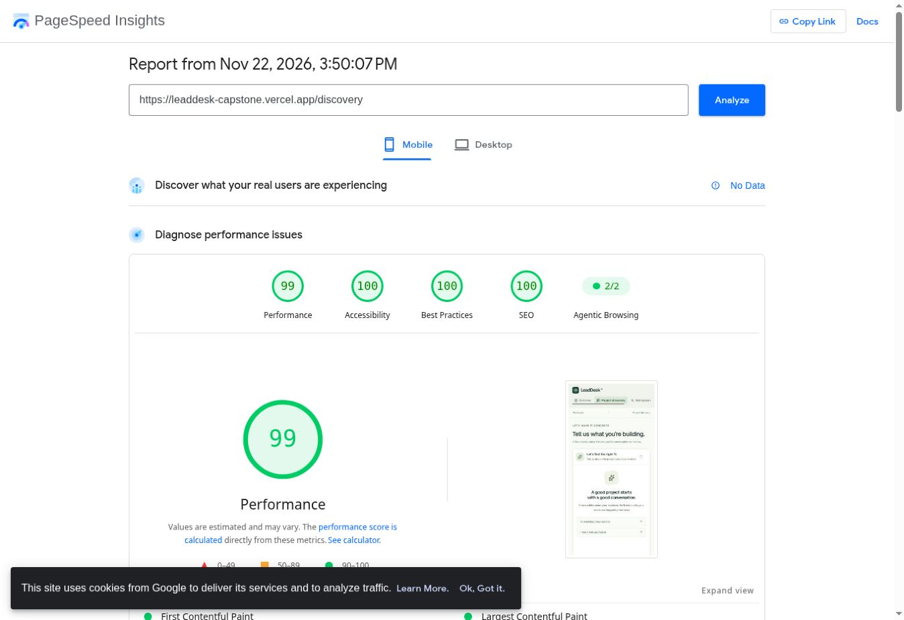
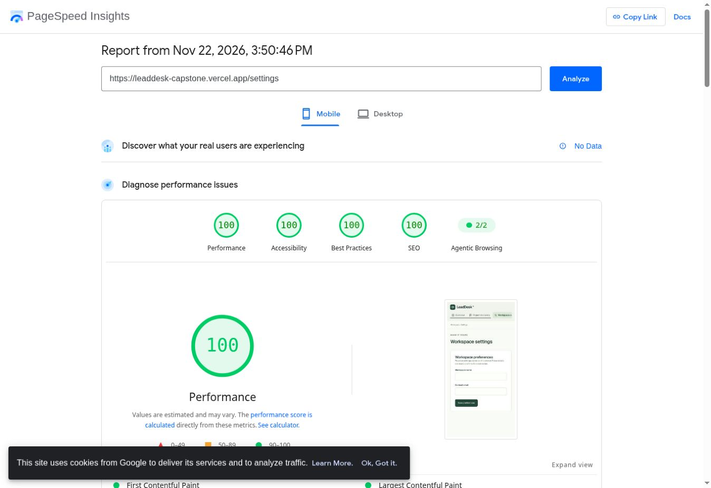
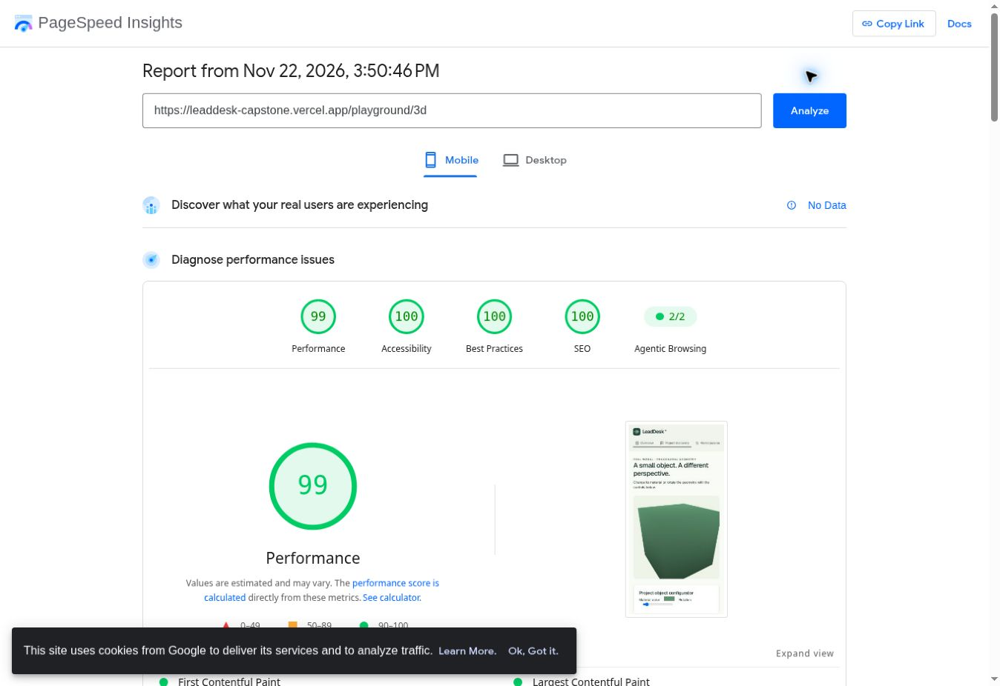
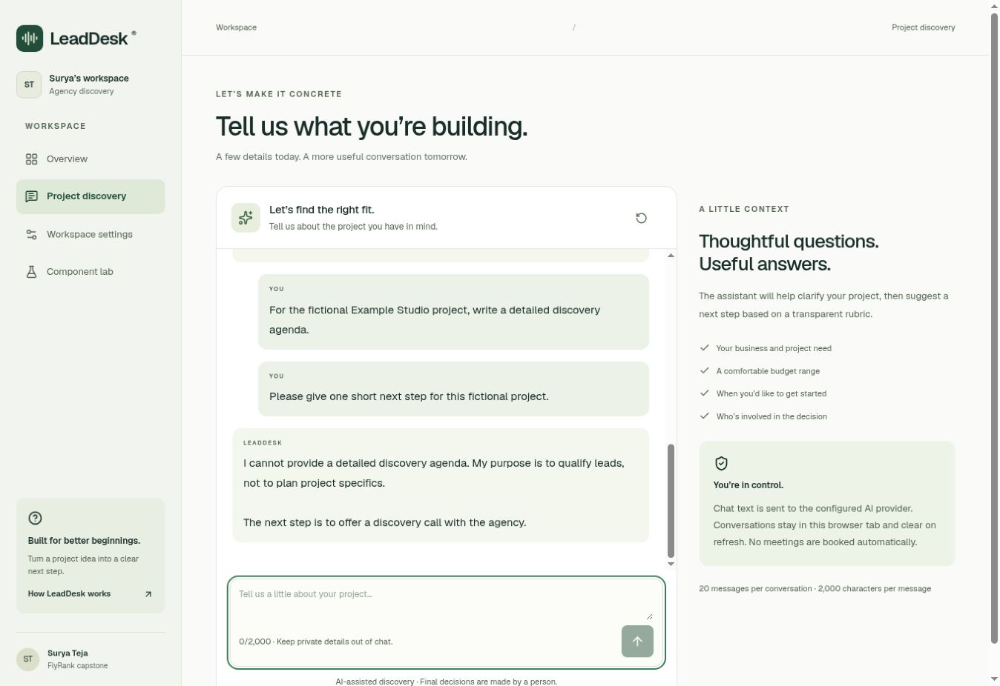

# FE-10 · LeadDesk accessibility and performance audit

Production baseline and keyboard audit conducted on 22 November 2026. The fix is in commit `d04fb5b`. The production runs below preceded deployment of the fix.

## Mobile Lighthouse

PageSpeed Insights mobile lab measurements. Each route met the 90-point target for Performance and Accessibility in the baseline. Scores can vary between runs.

| Route | Performance | Accessibility | FCP | LCP | TBT | CLS |
| --- | ---: | ---: | ---: | ---: | ---: | ---: |
| [Overview](https://pagespeed.web.dev/analysis/https-leaddesk-capstone-vercel-app/pol9edw15g?form_factor=mobile) | 100 | 100 | 0.9 s | 0.9 s | 0 ms | 0.003 |
| [Discovery](https://pagespeed.web.dev/analysis/https-leaddesk-capstone-vercel-app-discovery/8lhwdb1a9n?form_factor=mobile) | 99 | 100 | 1.2 s | 1.2 s | 90 ms | 0 |
| [Settings](https://pagespeed.web.dev/analysis/https-leaddesk-capstone-vercel-app-settings/pxh2bu913r?form_factor=mobile) | 100 | 100 | 0.9 s | 0.9 s | 10 ms | 0 |
| [3D playground](https://pagespeed.web.dev/analysis/https-leaddesk-capstone-vercel-app-playground-3d/2cinxgkh4j?form_factor=mobile) | 99 | 100 | 0.9 s | 0.9 s | 100 ms | 0.001 |

The two historical Discovery runs each scored 100 Performance and 100 Accessibility on the unchanged deployment. The fresh Discovery baseline measured 99 and 100 before the fix. Post-deployment scores, screenshots, and Lighthouse deltas are pending.

[Historical Discovery run 1](https://pagespeed.web.dev/analysis/https-leaddesk-capstone-vercel-app-discovery/etf8rox664?form_factor=mobile) · [Historical Discovery run 2](https://pagespeed.web.dev/analysis/https-leaddesk-capstone-vercel-app-discovery/ylu1th75aa?form_factor=mobile)

### Production baseline screenshots

## WAVE findings and changes

Historical narrow-viewport WAVE extension counts supplied with the FE-10 handoff. The FlyRank sign-in requirement prevented direct comparison with the current submission attachment.

| Route | Errors | Contrast errors | Alerts |
| --- | ---: | ---: | ---: |
| Overview | 0 | 1 | 9 |
| Discovery | 0 | 1 | 2 |
| Settings | 0 | 0 | 1 |
| 3D playground | 0 | 0 | 1 |

- The shared breadcrumb separator now inherits the top bar’s `#52634f` foreground. WAVE previously reported 2.23:1 for `#a2ada2` on `#fafbf8`. The WCAG relative-luminance calculation for the new color pair gives 6.21:1, an increase of approximately 3.98 using the reported baseline. This is a calculation from the CSS values. The deployed WAVE contrast rerun is pending.
- The historical counts include eight small-text alerts on Overview and one on Discovery. The fix increases small visible labels and supporting text to 12–13 px, including relevant navigation, top-bar, hero, workflow, footer, and chat text. The hero details and footer can wrap. The exact WAVE nodes and remaining alert counts need a WAVE extension pass at a narrow viewport.
- Each route historically showed a redundant-link alert for the LeadDesk brand and the Overview navigation item. The brand gives users a conventional route home, while Overview is the explicitly labeled workspace navigation item.
- In this session the WAVE public scanner displayed “This page couldn’t load” in its report frame, and the Chrome Web Store disabled “Add to Chrome” for the extension. The available desktop browser was Chromium. A new WAVE result and a zero-error claim remain pending.

## Keyboard-only production test

1. From Overview, tabbed to Project discovery and opened it with Enter.
2. Tabbed to the composer, typed fictional details for Example Studio, tabbed to Send message, and pressed Enter. The chat displayed its thinking state and returned a Priority result of 100 with score reasons, an assistant reply, and a suggested discovery call.
3. Typed a second fictional request, submitted with Enter, tabbed from the composer to Stop generation, and pressed Space. The pending response ended and the composer was usable again.
4. Tabbed back to the composer and sent a follow-up. The assistant returned a suggested next step. Focus had dropped to the page after Stop in the baseline.

Source review found a named conversation log with `aria-live="polite"` and `aria-relevant="additions text"`, plus a separate polite status region for chat state. The keyboard run and DOM inspection measured browser behavior. Audio announcements with a screen reader were outside this run.

The local fix returns focus to the composer on activation of Send or Stop. The unit tests verify focus after Send and keyboard activation of Stop. Type checking, the production build, and 43 unit tests across eight files passed. Coverage in the configured core-component scope was 82.05% statements and 83.16% lines. Playwright browser-suite execution was blocked by local Chromium startup restrictions and a denied browser download.

## Completion status

The fix and baseline evidence are committed locally. Completion requires pushing the fix, verifying a Ready production deployment at the intended Git revision, recording after measurements and screenshots, confirming WAVE results and keyboard behavior on that deployment, then updating and verifying the existing FE-10 submission.
