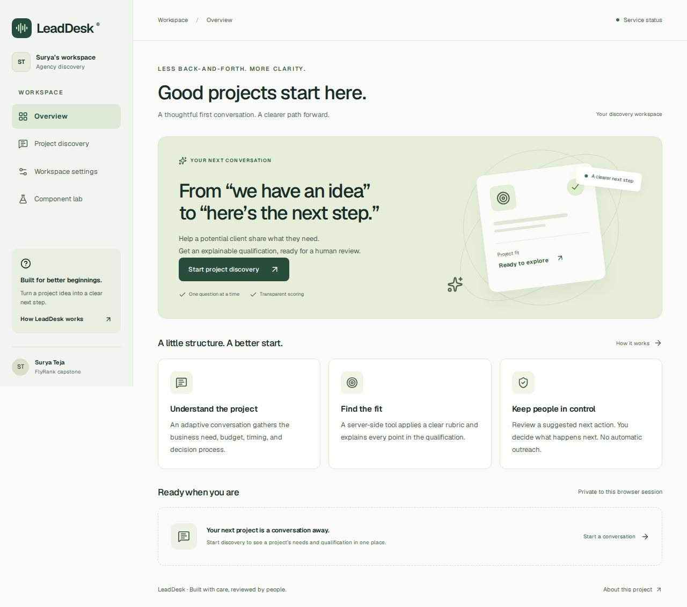

# LeadDesk

LeadDesk helps a small agency qualify an incoming website or app inquiry. A guided AI conversation gathers the visitor’s business need, budget, timing, and purchasing authority. A typed server tool produces an explainable score and a suggested next action for a person to review.

Built for Surya Teja’s FlyRank Front-end AI Engineering internship.



## Current status

The application code, accessible component playground, WebGL experiments, unit tests, and CI workflow are implemented. The production build, 19 unit/component tests, mocked end-to-end flow, and phone/desktop axe and overflow checks have passed in GitHub Actions at commit 07b9086. Live provider verification, deployment, the deployed performance audit, and FlyRank submissions still need completion. This repository is a work in progress.

## Run locally

Requires Node.js 24 LTS and npm. From this repository:

```bash
npm ci
cp .env.example .env.local
npm run dev
```

Open http://localhost:3000. On Windows, use Git Bash for the copy command, or copy `.env.example` to `.env.local` in File Explorer.

Add a Google AI provider key to `.env.local` to enable real AI responses. Without it the interface remains navigable and the chat shows an explicit configuration error. Sample data on `/playground/tools` demonstrates tool states independently of the AI provider. It is labeled as sample data.

## Environment variables

| Name | Required | Purpose |
| --- | --- | --- |
| `GOOGLE_GENERATIVE_AI_API_KEY` | For live chat | Server-only Google AI provider credential. Keep in `.env.local` or the deployment host’s secret settings. |
| `AI_MODEL` | Optional | Defaults to `gemini-2.5-flash`. Select a model available to your provider account. |

## Routes

| Route | Purpose |
| --- | --- |
| `/` | Workspace overview |
| `/discovery` | Streaming project-discovery conversation |
| `/settings` | Validated, device-local workspace preferences |
| `/about` | Scoring, privacy, and product scope |
| `/health` | Server-rendered fetch of `/api/health` |
| `/playground` | Custom modal, tabs, disclosure, shadcn references, and stateful button |
| `/playground/tools` | Four labeled tool-state fixtures |
| `/playground/3d` | Lazy-loaded procedural WebGL cube with color and rotation controls |
| `/playground/shader` | Custom GLSL hero with time, resolution, and pointer uniforms |

## Architecture

Next.js App Router supplies server-rendered route shells and server-only API handlers. React client components own conversation state, forms, keyboard widgets, and visual experiments. Tailwind and shared CSS tokens style the interface. Geist is bundled locally.

`src/app/api/chat/route.ts` validates messages, enforces size and request limits, and calls the Google provider through AI SDK `streamText`. `src/lib/ai-config.ts` holds the model and system prompt. The system prompt asks one question at a time, collects supplied facts, and calls a qualification tool. `src/lib/qualification.ts` contains the Zod schema and deterministic scoring rubric. `src/components/chat.tsx` uses `useChat` to consume typed stream parts, stop generation, retain partial responses, and retry failures.

The app does not claim to book meetings, email leads, or store a CRM record. Conversation state lasts for the current tab lifetime and clears on refresh. Chat text is transmitted to the configured AI provider. Workspace preference fields stay in localStorage and are excluded from model requests.

## Tool contract

**Name** `qualifyLead`

| Input | Type |
| --- | --- |
| `company` | Trimmed string, 2–100 characters |
| `project` | Trimmed string, 10–1,000 characters |
| `budget` | `under-5k`, `5k-15k`, `15k-plus`, or `unknown` |
| `timeline` | `this-month`, `this-quarter`, `exploring`, or `unknown` |
| `decisionMaker` | Boolean confirmed by the visitor |

Returns those fields plus `score` (0–100), `category` (`Priority`, `Nurture`, or `Discovery`), `reasons` (string array), and `nextAction` (string).

Budget contributes 0–40, timing 0–30, authority 0 or 20, and a stated need 10 points. Thresholds are 70 for Priority and 40 for Nurture. The four tool states show collection progress, supplied input under review, a result card, or a recoverable error. Client rendering checks the result shape before showing it.

## Verification

```bash
npm run typecheck
npm run test:coverage
npm run build
npx playwright install chromium
npm run test:e2e
```

Unit/component tests mock chat and never call a live provider. The Playwright primary-flow test supplies a mock AI SDK stream, checks typed result rendering, injects a 503, and checks retry. The axe test checks key pages at 375 px and 1280 px. CI runs checks on pushes and pull requests. See `docs/VERIFICATION.md` for measured results and limitations.

## Deployment

Import this repo into Vercel as a Next.js application, configure the server-only provider key, and deploy. The health page fetches its same-origin API in the browser, including on protected previews. Git-connected deployment should create a preview per change. Follow `docs/DEPLOYMENT.md`; deployment has not been claimed complete.

The route limits conversation length, request size, output tokens, step count, and time. Its per-instance rate limiter is a baseline; a public deployment should also enable a host-level WAF/rate rule and provider spending/quota controls. In-memory rate windows reset on cold starts and are not shared across instances.

## AI-assisted work

Codex implemented the project in ChatGPT Work with the user’s authorization. The initial storefront placeholder was replaced after reading FlyRank’s current streaming-chat and tool-calling requirements. The AI reviewed the README and added runnable setup instructions, the environment table, route mapping, tool contract, and explicit completion status.

Verification caught an accessibility regression: a grouped focusable-element selector returned an unexpected order in the test DOM, allowing Shift+Tab to leave the custom dialog. Changing the selector to a single `:is(...)` predicate preserved document order and made the regression test pass. Tests also verify invalid form descriptions, unknown qualification fields, partial streamed text, and malformed tool output.

AI generated both implementation and tests. A person should review the code and understand it before presenting it as their work. No personal study completion, time measurements, user research, live API success, or mentor acceptance is asserted here.

## Known limitations

- No authenticated multi-user workspace, database, CRM delivery, or booking service.
- Live AI requires a valid provider key and account quota; it is currently unverified.
- The automated streaming fixture is immediate. Real token timing, stop/re-send, mobile Safari behavior, WAVE, deployed Lighthouse, and cross-browser checks still require evidence.
- Two independent workflow-drill branches, the separate session-inspired React exercise, and AI Fluency course/personal-work evidence remain separate assignment work.
- Visual WebGL demos use procedural geometry (432 bytes of vertex data), cap pixel ratio at 1.5, stop hidden-tab rendering, and offer reduced-motion/static fallbacks. Device frame rate and deployed bundle impact are not yet measured.

## License

MIT. Adapted shadcn/ui reference source is also MIT. Its copyright notice is retained in `docs/THIRD_PARTY_LICENSES.md`.

## Qualification tool contract (FE07)

Definition: [`src/lib/tools.ts`](src/lib/tools.ts), registered as `qualifyLead` in the server chat route. `inputSchema` and `outputSchema` are Zod schemas from `src/lib/qualification.ts`. Execution validates input, applies the deterministic rubric, and validates the returned result. No external mutation, booking, email, or confirmation action occurs.

| Input field | Contract |
| --- | --- |
| company | Trimmed string, 2–100 characters |
| project | Trimmed string, 10–1000 characters |
| budget | under-5k, 5k-15k, 15k-plus, unknown |
| timeline | this-month, this-quarter, exploring, unknown |
| decisionMaker | Boolean; true only for confirmed purchasing authority |

The returned object contains all validated input fields plus `score` (integer 0–100), `category` (Priority, Nurture, Discovery), `reasons` (up to 10 strings), and `nextAction` (string). Budget adds 0/10/30/40, timing 0/5/20/30, confirmed authority 20, and a stated project 10. Scores at least 70 are Priority; 40–69 Nurture; below 40 Discovery.

The UI renders input-streaming as a preparation skeleton, input-available as a labeled input summary with execution feedback, output-available as a score card, and output-error as an alert with recovery guidance. Untrusted result data is validated before display. `/playground/tools` contains clearly labeled sample fixtures for all four states; `/discovery` runs the real server tool through Gemini. Fixtures do not claim a real execution failure or provider call. See [FE07 evidence](docs/FE07.md).

## Checkpoint 1 — resilient discovery (FE08)

[Failure inventory and sabotage checklist](docs/FE08.md) covers network loss, interrupted streams, provider errors, rate limits, slow and empty responses, incomplete/malformed tool results, and useful first-run states. Retry regenerates only the last assistant response and preserves visitor messages. Error bodies stay private. The browser suite exercises the same chat UI in Chromium and mobile WebKit, including screenshots of success and handled failures.

## Buttons with a Brain (Week 6 · FE-AA1)

Live demo: https://leaddesk-capstone.vercel.app/playground/buttons — select **Force success** or **Force failure**, then activate the save button. A disable toggle and reset control make the remaining cases inspectable. The save is explicitly simulated; it sends no data and requires no provider key.

The reusable [StateButton](src/components/state-button.tsx) covers idle, hover/focus, press, loading, success, error/retry, disabled, and return to idle. Hover/press use 120ms ease-out for prompt acknowledgement. State faces crossfade and shift 4px over 200ms with cubic-bezier(.2,.8,.2,1), while a single 240ms nudge marks an error. Success holds 1.8s, error 3.2s, then the button returns to idle; the result text persists. Fixed dimensions avoid layout shifts, and only transform/opacity animate. Reduced motion removes animation while keeping all feedback and keyboard focus. [Requirements and verification](docs/FE-AA1.md).

## Testing pass (FE09)

Run `npm ci`, `npm run typecheck`, `npm run test:coverage`, `npm run build`, `npx playwright install --with-deps chromium webkit`, and `npm run test:e2e`. AI responses are mocked in tests; no real provider calls or credentials are needed. CI runs the same commands on push and pull requests, with coverage gates and test-evidence artifacts. [FE09 test inventory and recorded failing-test fix](docs/FE09.md) maps component cases, primary-flow coverage, and verification evidence.
