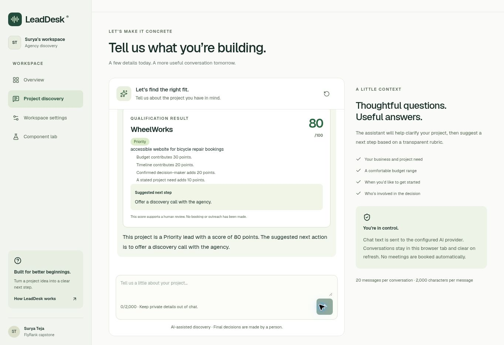
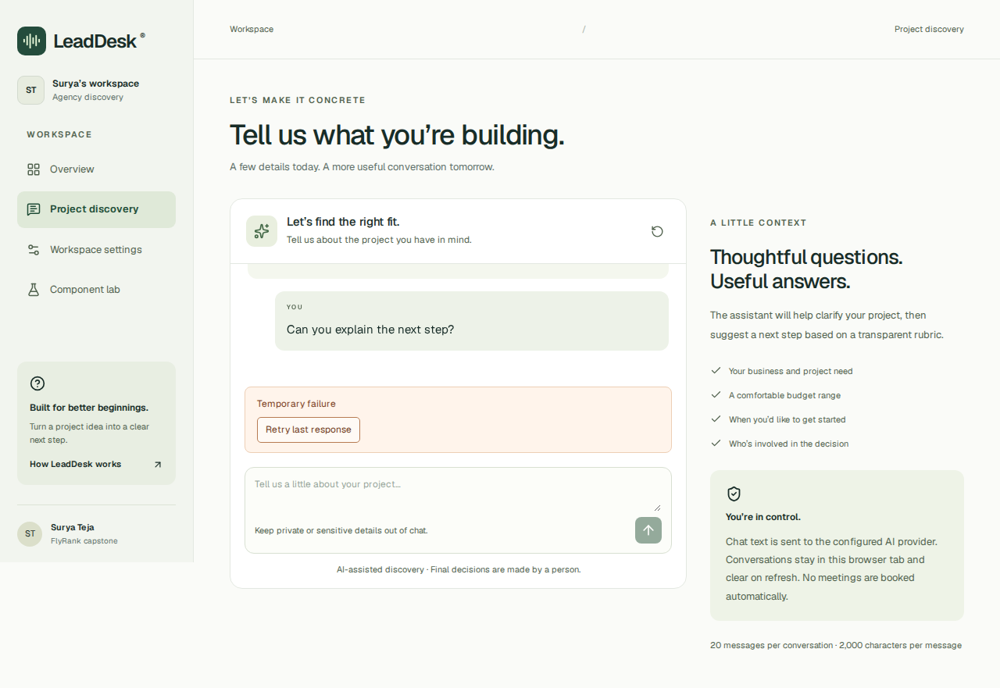

# LeadDesk

An AI-assisted project discovery workspace by Surya Teja. Visitors describe a website or app project; a streaming assistant gathers requirements and calls a typed qualification tool. The resulting score explains its reasoning and suggests a next action for a person to review.

**Production:** https://leaddesk-capstone.vercel.app/  
**Try discovery:** https://leaddesk-capstone.vercel.app/discovery





## Run from a fresh clone

Requires Node.js 24 LTS, Git, and npm.

```bash
git clone https://github.com/suryateja69/flyrank-fe-capstone.git
cd flyrank-fe-capstone
npm ci
cp .env.example .env.local
npm run dev
```

Open http://localhost:3000. Windows users can run these commands in Git Bash, or copy `.env.example` to `.env.local` with File Explorer. Set the provider key in `.env.local` before testing live chat. Never commit that file.

Without a key, navigation and sample tool fixtures work; chat displays a recoverable configuration error. For a production build locally:

```bash
npm run build
npm start
```

## Environment

| Variable | Required | Default / purpose |
| --- | --- | --- |
| GOOGLE_GENERATIVE_AI_API_KEY | Live chat only | Server-only Gemini credential; configure locally or in Vercel Production secrets. Never use a NEXT_PUBLIC_ prefix. |
| AI_MODEL | No | gemini-2.5-flash; override with a model available to your account. |

No database, OAuth application, or browser API key is required.

## Use the primary flow

Open Project discovery, describe your company and project, then provide budget, timeline, and purchasing authority when asked. The assistant streams a reply and invokes `qualifyLead` once it has the needed facts. Review the score, reasons, and suggested action. Stop generation interrupts a response; Retry recovers from errors; Start a new conversation clears the current session.

A fictional deployment smoke test on 22 November 2026 used Example Studio, a customer booking application, a $20,000 budget, launch this month, and confirmed decision-making authority. The production provider returned the typed Priority card with score 100 and a human-review suggestion. No booking or outreach occurred.

## Architecture

| Layer | Responsibility |
| --- | --- |
| Next.js App Router | Route shells, server API handlers and production rendering |
| React client components | Chat state, forms, accessible widgets and visual experiments |
| AI SDK + Google provider | Validated messages, streaming response and typed tool parts |
| Zod + deterministic qualification | Input/output contracts and explainable scoring |
| Shared CSS + Tailwind | Responsive layout, focus treatment and reduced-motion styles |
| GitHub Actions + Vercel | Automated checks and Git-connected deployment |

Request path: browser `useChat` → `POST /api/chat` → origin/rate/size/message validation → Gemini `streamText` → `qualifyLead` → typed stream → validated result card.

The tool accepts company, project, budget, timeline and decisionMaker. Budget contributes up to 40 points, timing up to 30, authority 20, and a stated need 10. Scores 70+ are Priority, 40–69 Nurture, and below 40 Discovery. The tool validates its output and has no external side effects.

## Decisions and scope

- Server-only credentials prevent provider secrets reaching the browser.
- Deterministic tool scoring makes recommendations explainable instead of asking the model to invent a score.
- Typed stream parts show preparation, input review, result and recoverable failure states.
- Workspace preferences stay in localStorage and are excluded from model requests.
- Conversations live in the current tab and clear on refresh; submitted chat text goes to the configured AI provider.
- No CRM integration, database, authentication, automatic email or meeting booking is claimed.
- Procedural WebGL avoids large 3D assets. Pixel ratio is capped at 1.5, hidden tabs pause rendering, and reduced motion/unavailable WebGL use a static fallback.

## Production hygiene

The chat route rejects foreign origins, caps the request at 32,000 characters and the conversation at 20 messages, rejects system-role injection, validates AI SDK message structure, and restricts generation to 800 output tokens and three steps. The UI caps each new visitor message at 2,000 characters.

Per-instance rate limiting allows 10 requests per client key and 60 globally per minute, returning 429 with Retry-After. The streaming handler exports `maxDuration = 30`, applies a 25-second abort timeout, and propagates client cancellation.

The in-memory limiter resets on cold starts and is not shared across server instances; it is a baseline, not a distributed spending guarantee. Host WAF rules and provider spending quotas are recommended; this README does not claim they are configured. Errors shown to visitors omit provider internals.

## Deployment and rollback

Vercel hosts the public production domain above. The repository's main branch is connected to production deployment. In Vercel, import the repository with the Next.js preset, set the environment variables for Production, and deploy. Changing environment variables requires a new deployment.

After deployment, check the overview, discovery, settings and health pages; send a fictional project and confirm a streamed response and result card. Inspect build/runtime logs if a request fails. Roll back using a previously Ready deployment in the Vercel dashboard if needed. A custom domain is optional; the supplied vercel.app domain uses HTTPS.

## Routes

| Route | Purpose |
| --- | --- |
| / | Overview |
| /discovery | Live streaming qualification |
| /settings | Device-local workspace preferences |
| /about | Scoring, privacy and scope |
| /health | API health display |
| /playground | Accessible component examples |
| /playground/tools | Explicitly labeled sample tool states |
| /playground/buttons | Simulated save micro-interactions |
| /playground/3d | Procedural cube configurator |
| /playground/shader | Personalized GLSL hero |

## Verification

```bash
npm run typecheck
npm run test:coverage
npm run build
npx playwright install chromium webkit
npm run test:e2e
```

Unit/component and end-to-end fixtures mock AI responses and do not spend provider credits. The browser configuration includes desktop Chromium and selected mobile WebKit cases. WebKit emulation does not certify real iPhone Safari.

TypeScript and the production build passed during the Week 8 shader update. The deployed discovery flow was verified with a real provider response on 22 November 2026 in Chrome. Firefox, desktop Safari and physical mobile Safari were not available in the review browser and are **not claimed as tested**. WAVE and the full FE-10 audit remain separate unfinished verification; Lighthouse alone does not prove accessibility. Existing screenshots are labeled evidence from earlier checks, not new cross-browser evidence.

## How AI tools built this

Codex in ChatGPT Work generated the Next.js/React implementation, tool schemas, deterministic rubric, streaming UI, component states, GLSL renderer, tests and documentation with the user's authorization. It reviewed FlyRank's briefs and changed an initial storefront direction into a project-discovery workspace matching the streaming/tool requirements.

A concrete verification-driven fix changed the custom dialog's grouped focus selector to a single `:is(...)` selector so document order was preserved and Shift+Tab stayed inside the modal. The tool UI validates malformed results rather than trusting generated data. The shader update changed a 70dvh stage to a minimum 100dvh and removed the constrained page wrapper. For this production task, Codex exercised a fictional live qualification and replaced stale deployment claims with this runnable README.

AI also wrote tests, so passing tests are evidence with limits, not independent human review. Surya should understand the code before a mentor walkthrough. No mentor acceptance, personal course completion, or unperformed device testing is asserted.

## Supporting documentation

- [Tool contract and states](docs/FE07.md)
- [Error and recovery inventory](docs/FE08.md)
- [Button motion and states](docs/FE-AA1.md)
- [Shader walkthrough and fallback](docs/FE-AA3.md)
- [Earlier verification record](docs/VERIFICATION.md)

## License

MIT. Adapted shadcn/ui reference code retains its notice in [third-party licenses](docs/THIRD_PARTY_LICENSES.md).
