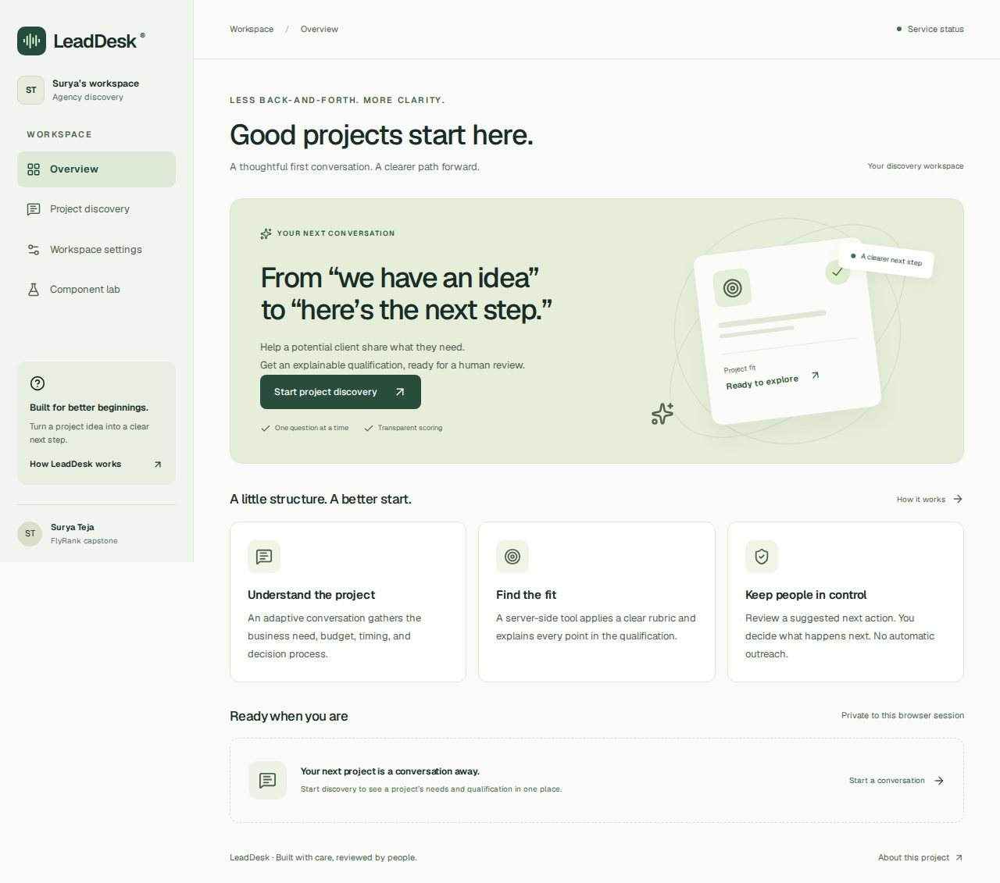
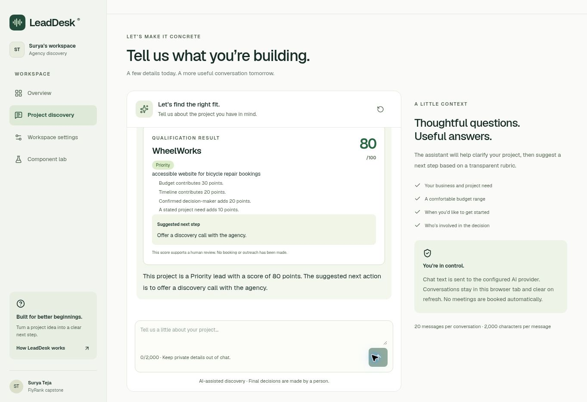
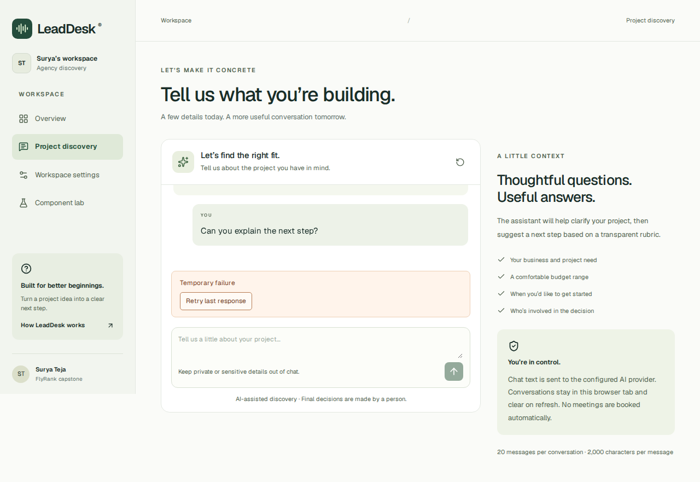

# LeadDesk — production AI product capstone

Prepared 22 November 2026 with Codex assistance for Surya Teja. This is an evidence-backed technical portfolio entry; reflections below describe observed engineering trade-offs, not an invented personal testimonial.

## Project brief

Small agencies lose time collecting incomplete project inquiries. LeadDesk gives visitors a guided discovery conversation, then turns their supplied company, project, budget, timing and purchasing authority into an explainable qualification card. I chose this scoped workflow because AI can interpret conversational requirements while a deterministic tool keeps scoring inspectable and a person remains responsible for the next action.

## Live application and repository

- [Production](https://leaddesk-capstone.vercel.app/)
- [Discovery flow](https://leaddesk-capstone.vercel.app/discovery)
- [Repository](https://github.com/suryateja69/flyrank-fe-capstone)
- [Final README](../README.md)

The README contains clone/run instructions, environment variables, architecture, decisions, AI integration, limits and operation guidance. Next.js serves route shells and server handlers; React consumes AI SDK streams; Zod validates typed tool input/output. Gemini gathers facts under the [server prompt](../src/lib/ai-config.ts); [qualifyLead](../src/lib/tools.ts) calculates a deterministic score. No automatic outreach or booking occurs.

## Testing evidence

A fresh local run on 22 November passed **43 tests across 8 test files**. The eight core component source files used by that run were compared with GitHub main and matched by Git blob hash. Source checkout base: 048ef48dd6379b21def531c8dcf4bf17869c1cf9, with the Week 8 shader layout edits applied.

| Configured core-component metric | Result |
| --- | ---: |
| Statements | 81.81% (189/231) |
| Branches | 71.87% (138/192) |
| Functions | 77.77% (49/63) |
| Lines | 82.91% (165/199) |

Coverage scope is the eight files configured in vitest.config.ts, not all repository files. Eight of fourteen component source files are included (57.1% by file count); this is distinct from execution coverage. Playground coverage remains low and is a future improvement.

[Raw scoped coverage output](capstone-core-coverage.json). Run `npm run test:coverage` to reproduce.

[CI run 45005603493](https://github.com/suryateja69/flyrank-fe-capstone/actions/runs/45005603493) was independently checked as completed/success at e2b02c651a53e1246e4289622ce14f60ca65958b. Its quality job passed typecheck, tests, build and **21 Playwright tests**. [Uploaded test evidence](https://github.com/suryateja69/flyrank-fe-capstone/actions/runs/45005603493/artifacts/14747812296) includes the browser report, results and coverage. This historical run is not presented as a new full browser audit of the latest deployment.

## Performance and accessibility evidence

The supplied mobile PageSpeed evidence records:

| Route | Performance | Accessibility |
| --- | ---: | ---: |
| Home | 100 | 100 |
| Discovery | 100 | 100 |
| 3D playground | 97 | 100 |

- [Home report](https://pagespeed.web.dev/analysis/https-leaddesk-capstone-vercel-app/89n67n4f0x?form_factor=mobile)
- [Discovery before](https://pagespeed.web.dev/analysis/https-leaddesk-capstone-vercel-app-discovery/etf8rox664?form_factor=mobile)
- [Discovery after](https://pagespeed.web.dev/analysis/https-leaddesk-capstone-vercel-app-discovery/ylu1th75aa?form_factor=mobile)
- [3D report](https://pagespeed.web.dev/analysis/https-leaddesk-capstone-vercel-app-playground-3d/8wzue51qh4?form_factor=mobile)

The provided discovery screenshots were inspected and show 100 performance and accessibility in both runs. Identical scores are not an invented improvement.

Axe/overflow checks are part of the earlier passing CI browser suite; see [verification record](VERIFICATION.md) and its [passing CI](https://github.com/suryateja69/flyrank-fe-capstone/actions/runs/44672327960). **Concrete audit-driven improvement:** muted text was darkened after contrast findings. A subsequent transient label-contrast finding was fixed by starting the label animation at 90% opacity. The dialog focus-order regression was also fixed and tested. These are historical fixes, not changes newly invented for this submission.

No WAVE run, exhaustive WCAG AA certification, physical Safari pass, or fresh whole-site axe scan is claimed. Reduced motion, semantic labels, polite stream announcements, native Stop controls and visible focus are implemented. A manual full assistive-technology audit remains appropriate.

## Filled deployment and operation checklist

Sign-off scope: Codex verified the checked items on 22 November 2026; this is not a mentor or human security sign-off.

- [x] Public HTTPS production URL reachable.
- [x] Vercel production deployment Ready at e3a9f5d398caeede6749c073ccd6e4d31dd70a83.
- [x] Provider configured: a real fictional Example Studio inquiry returned a Priority qualification score of 100 and explanatory response.
- [x] Credentials stay server-side; environment setup documented without exposing values.
- [x] Rate limits, message/request caps, schema/role validation and generation limits reviewed.
- [x] maxDuration 30 seconds and abort timeout 25 seconds configured.
- [x] TypeScript and production build passed during the preceding Week 8 implementation check.
- [x] Fresh core-component unit/coverage run passed.
- [x] Recovery screenshots and deterministic retry/error fixtures provided.
- [x] Monitoring and rollback instructions documented.
- [ ] Latest production site fully audited in Firefox, desktop Safari and physical mobile Safari.
- [ ] WAVE and complete manual accessibility audit.
- [ ] Shared distributed rate storage and provider spending-limit configuration independently verified.

### Safe failure and operations

The UI retains visitor messages for retry after network/provider errors, supports Stop, labels sample fixtures, and refuses malformed tool results. It never substitutes sample data for a live provider success. The server uses per-instance request limiting (10 per client and 60 globally per minute), 32,000-character requests, 20-message conversations, 800 output tokens and a three-step maximum. Cold starts/multiple instances weaken in-memory limits; host WAF rules and provider quotas remain recommended.

Monitor `/api/health` for availability/configuration status and Vercel logs for generic `chat_generation_failed` errors. Health does not prove provider availability and no external uptime monitor is claimed. To roll back, promote the last known Ready deployment in Vercel, check health and the discovery flow, then fix on a branch and redeploy. Do not log visitor text or secrets to diagnose failures.

## Engineering reflection (AI-assisted)

The hardest technical boundary was coordinating streamed text, typed tool states and recoverable failures. The visible UI must distinguish collecting input, executing a tool, valid output and interrupted output; displaying any object as a result would hide real errors. Schema validation and deliberately malformed fixtures made this boundary testable.

For the next iteration, I would add shared rate-limit storage and a repeatable browser/accessibility matrix earlier, then record evidence at each deployment commit. The current scoped coverage is useful but hides weak playground coverage if reported as a single repository-wide percentage.

A surprising finding was that accessibility can fail during a transition even when both final states pass: text fading from zero opacity temporarily lost contrast. Keeping the initial opacity high preserved readability. Another lesson is that a 100 Lighthouse accessibility score does not replace keyboard, WAVE, assistive-technology or real-device checks.

## AI usage and remaining work

Codex generated and revised implementation, tests, documentation and this portfolio entry. The user supplied project direction, account access and existing audit material. See the README's concrete AI workflow section. This entry does not assert human authorship of unreviewed AI text, external user research, or mentor approval.

Future improvements: broader component coverage, physical-device testing, distributed abuse protection, an independently verified accessibility audit and durable opt-in conversation storage if product needs justify it.
