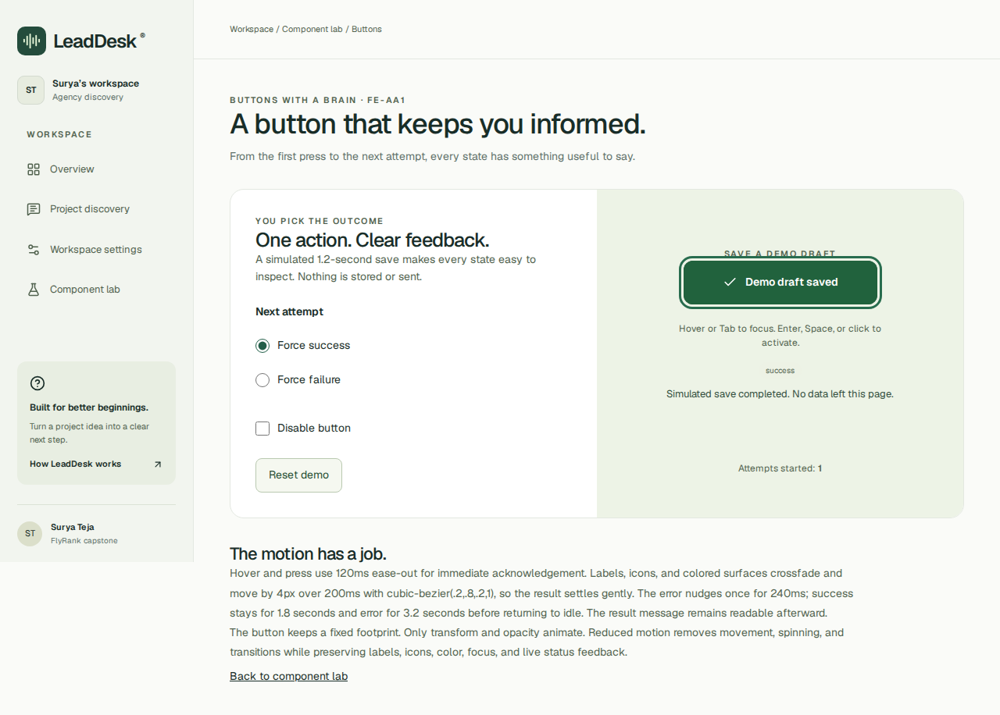
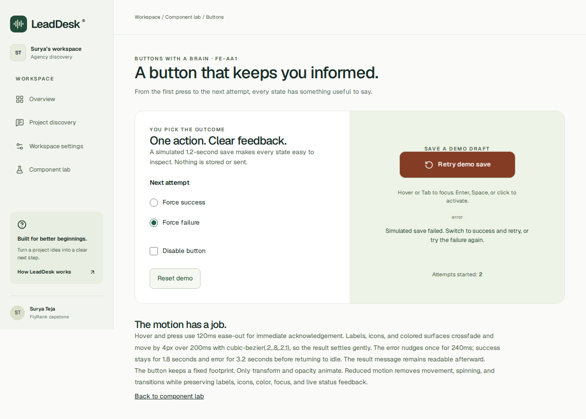

# FE-AA1 — Buttons with a Brain: Motion & State Micro-interactions

Assignment: Week 6, first Frontend AI Engineering task.

Demo: https://leaddesk-capstone.vercel.app/playground/buttons

## Reviewer walkthrough

1. Select Force success and activate Save demo draft. Watch loading, success, then idle.
2. Select Force failure and activate the same button. The error nudge and Retry demo save label appear. Switch to success and retry during that transition, or let the error return to idle.
3. Tab to the action; Enter or Space activates it. The focus ring fades in. Repeated activations while loading produce one attempt, shown by the counter.
4. Toggle Disable button, then enable it. Reset demo also cancels an in-flight simulation and clears its timers.
5. Enable the OS/browser reduced-motion setting. Spinning, nudges, hover movement, and transitions disappear, while labels, icons, color, focus, and live status still communicate the same outcome.

## Implementation choices

| Requirement | Implementation |
| --- | --- |
| Five or more states | Idle, hover/focus, active press, loading, success, error, disabled |
| Intentional timing | 120ms ease-out acknowledgement; 200ms state handoff using cubic-bezier(.2,.8,.2,1); 240ms one-time error nudge |
| Result retention | Success stays 1.8 seconds; error 3.2 seconds. Button returns to idle; last-result text persists |
| Compositor-friendly motion | Only transform and opacity animate; state surfaces and labels crossfade inside a fixed 248×56px footprint |
| Interruptible | CSS transitions resume from their current interpolated values; synchronous busy guard stops spam-click duplicates; new action clears result timer |
| Async cancellation | AbortController and generation guard prevent an unmounted/reset action from publishing stale results |
| Keyboard and assistive technology | Native button, visible focus ring, current accessible name, aria-busy/aria-disabled, polite atomic status |
| Reduced motion | Motion is removed; all result text, status, icons, color, and focus remain |
| Reviewable outcomes | Explicit Force success / Force failure radios; no random chance needed |

The action is a deliberately simulated 1.2-second save. No email, booking, external API, or actual draft persistence is claimed. The component accepts an async action and can be reused with a real capstone action later.

Source: src/components/state-button.tsx, src/components/button-demo.tsx, and the FE-AA1 styles in src/app/globals.css. Demo entry: src/app/playground/buttons/page.tsx. Timing rationale also appears directly on the page and in README.

## Validation

Verified on 22 November 2026: TypeScript, all 43 unit/component tests, production build, and all 21 browser tests passed in [CI run 45005603493](https://github.com/suryateja69/flyrank-fe-capstone/actions/runs/45005603493). This includes real Tab/Enter/Space activation, duplicate-event protection, forced error/retry, stable dimensions, reduced motion, axe checks, and iPhone 13 mobile WebKit emulation. A physical iPhone was not used.

The public Production deployment reached READY: https://leaddesk-capstone-e2hba8g8m-badboysuryatej-9407.vercel.app/playground/buttons . Its loading, success, and failure transitions were manually exercised through the live controls. No credentials or provider API are required by the demo. Unit tests cover duplicate activation, success/idle, retry during the error dwell, stale-timer prevention, disabled activation, cancellation, forced failure, and reset. Browser tests cover real Tab/Enter/Space, stable dimensions, forced failure/retry, hover, reduced motion, axe accessibility, and phone layout in Chromium and mobile WebKit.

## Screenshot evidence

These unedited screenshots come from the passing browser run and demonstrate the same deployed component with deterministic simulated outcomes.

