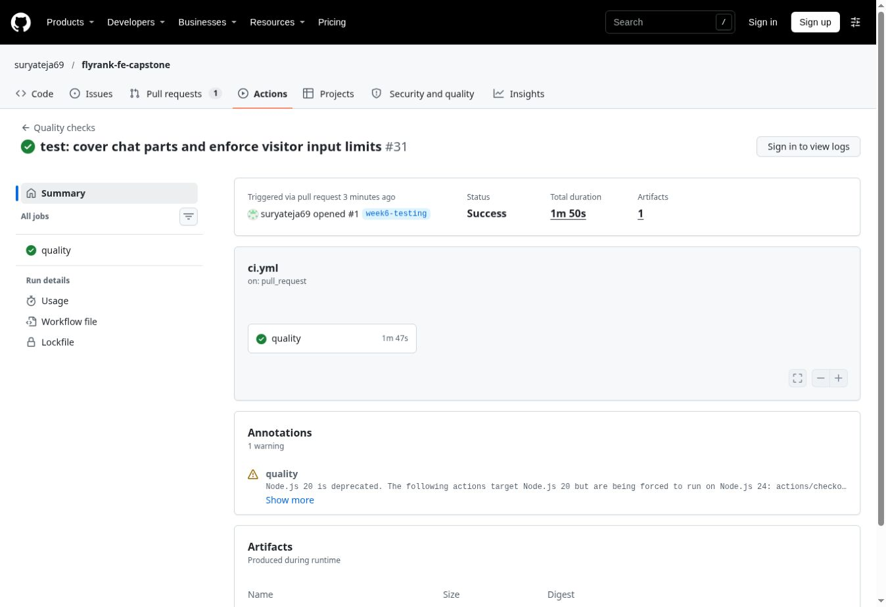

# FE09 — Testing pass

The LeadDesk suite uses Vitest 4, React Testing Library, user-event, and Playwright. Tests exercise behavior through accessible roles, labels, visible text, and user interactions. No component test uses a test ID or CSS class selector.

## Test inventory

| Risk / requirement | Test files and meaningful assertions |
| --- | --- |
| Message renderer: text and every applicable part type | tests/message-parts.test.tsx: escaped/ordered text; static tool input-streaming, input-available, output-available, output-error; dynamic known tool; invalid dynamic output; unsupported tool, reasoning, step, source URL/document, file, and data parts are deliberately ignored without losing public text |
| Validated form | tests/components.test.tsx validates field errors and persistence; tests/settings-resilience.test.tsx tests malformed cache, invalid stored shape, blocked storage, and preservation of the entered values |
| Tool-result component | tests/tools.test.tsx and tests/components.test.tsx cover collection, validated input review, scorecard output, execution error, malformed score/reasons, and input rejection |
| Chat pending / streaming / error | tests/chat.test.tsx covers blank input, pending feedback and Stop, incremental text, polite log, preserved reading position, error guidance, and retry |
| Primary flow end to end | e2e/discovery.spec.ts opens discovery from the homepage, sends project details, renders the typed score, injects a failed response, and retries without duplicating visitor messages |
| Failure and stream regression | e2e/edges.spec.ts and e2e/streaming.spec.ts exercise dropped connections, mid-stream retry, empty output, rate limits, slow response, stop, malformed tools, reading position, and subsequent turns |
| Motion and keyboard | tests/state-button.test.tsx and e2e/buttons.spec.ts verify the lifecycle, cancellation, repeated activation, keyboard focus, reduced motion, and stable dimensions |
| Server request boundaries | tests/chat-route.test.ts mocks the AI SDK/provider and checks safe 503, malformed JSON, 429, blank/over-limit messages, and the valid 2000-character boundary |

There are substantially more than the six required component cases. Existing query-selector assertions check absence of script elements (security), not CSS names. Browser tests that specifically inspect motion may select the motion component to inspect its computed CSS; component behavior tests remain independent of styling.

## No live AI in tests

Unit chat tests mock useChat; server tests replace the provider and streamText; browser tests intercept /api/chat or supply a controlled UI-message stream to the actual SDK parser. Fixtures are deterministic. CI explicitly supplies an empty provider-key environment variable, and no provider secrets are passed to Actions. The actual same-origin /api/health check is not an AI/provider call.

## AI assistant red → green fix

The assistant added two server-limit regressions and ran `npm test -- tests/chat-route.test.ts`. Both failed: blank text and 2001 characters returned HTTP 200 instead of 400. The composer had the limit, but the server did not enforce it. [Original failing run](testing/FE09-before-fix.txt).

The assistant then updated the actual POST handler to reject blank, over-2000-character, or non-text visitor messages before calling the provider. The exact 2000-character boundary remains accepted. It ran the full suite again and all 63 tests passed. [Passing local run](testing/FE09-after-fix.txt). No expectations were weakened, and no tests were skipped to obtain green.

## CI and merge gate

.github/workflows/ci.yml runs on both push and pull_request. The `quality` job runs TypeScript, component/route tests and coverage, a production build, and Playwright. Commands are sequential and failures stop the job; artifacts upload even on failure. Coverage gates are 80% statements, 70% branches, 75% functions, and 80% lines. HTML coverage, JSON summary, JUnit XML, browser traces/reports, and screenshots are uploaded as test-evidence.

Repository enforcement requires `quality` to be selected as a required status check for main. The GitHub connector cannot edit branch protection; authenticated repository settings are needed. That final setting and CI proof will be recorded before claiming merge enforcement is configured.

## Verification

TypeScript, all 63 unit/component/route tests, coverage gates, production build, and all 21 Playwright tests passed in [GitHub Actions run 45007432893](https://github.com/suryateja69/flyrank-fe-capstone/actions/runs/45007432893). This is the pull-request-triggered run for PR #1 against main. The screenshot below is an unedited capture of the actual GitHub run showing Success and the completed quality job. Coverage is scoped to the selected interactive components; local aggregate results were 82.68% statements, 76.04% branches, 77.77% functions, and 83.91% lines.

The CI workflow emits a non-failing annotation about action runtime upgrades; it does not indicate a test failure. Required branch protection is still pending an authenticated GitHub settings session; it is not claimed as enforced yet. The primary browser flow uses mock AI responses; these results do not claim model quality or live provider reliability.
